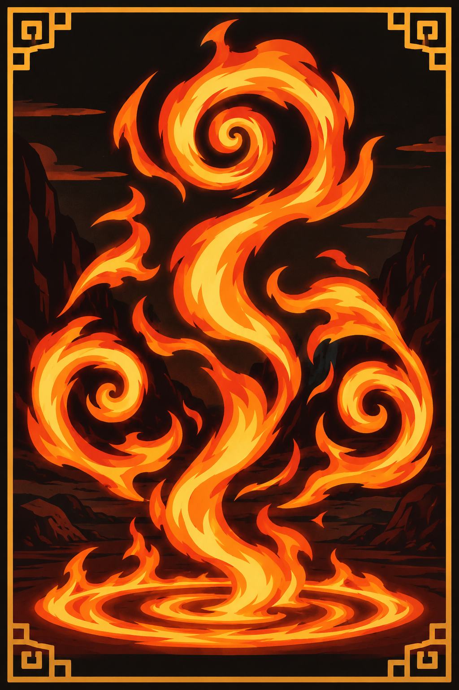

# Americans Should Die If The Private Sector Can't Get Under Control
## written by Richard Pham 

A LinkedIn article I wrote on 10/29/26. I will not be using that social media site for a while now.
---------------------------------------------------------------------------------------------------

*Image generated by ChatGPT.*

**These are simply my opinions and conclusions. I am not a professional economist or part of any financial institution.**  

The year is 2026. At this point in time, there is very little doubt in the minds of sane and honest people on the problems 
that American economic policy has caused. 

The big discussions went from blaming the former president Barack Obama, so that Trump gets elected, to the Covid-19 pandemic 
(forced lockdowns the chief symptom of this), and then to the A.I. Boom, which many, not only the anti-technology people, view 
as corporate thievery. 

The title, "Americans Should Die If The Private Sector Can't Get Under Control", sounds kind of scary, yes? Maybe even a 
threat? But no. That is the inevitable if the private sector can't get under control. 

There are problems here with the capital allocation. Those problems are not going away. Are these the waning years of 
what can be considered, the *Tyranny of the Oligarchs*? Or are they the beginning years of *Authoritarian America*? How funny, 
to ask these two questions on two extreme possibilities, when there is only one future moving forward. 

**No one should expect an FDR to come save the United States from these pressing economic problems anytime soon. By the way, 
FDR was called a class traitor for his economic policies, that which included the New Deal.** 

Just imagine, that kind of thinking has persisted to this day, despite the progress. One more colored friend, maybe even 
a black friend, in the classroom. Ten thousand less dollars in the personal bank account. Even less than that. Not ten thousand 
dollars less. A measly five hundred dollars above 0, if that. That would be more accurate. It makes some people wonder, what is 
capital? 

**It has become painfully clear that American leadership does not know how to help some of its most promising people.** 

The bitter explanation also has a humorous side to it. And it is this: the most promising people are supposed to be used. 
For these people, there is no liberation, no salvation, no nothing that is serene and soothing to the soul but responsibility, 
mental distress from thinking on other peoples' problems, and the list goes on. 

**Maybe there is no general solution available. Please. Help yourself some more! By any and all of your means, in this 
class-based society, as long as you don't dash your class expectations!** 

Unfortunately, if there was a solution that is be general for some of these problems, a good number of people will surely 
end in miserable ends, and abruptly at that. 

**Notice the American trend of removing or silencing experts. The trend was/is a toxic reaction between special interest groups 
and officially recognized government, many of whom are Aristocrats.** 

It is ill-advised to volunteer to jump into these arguments. There might be more underneath to these events than the 
so-called "growth of authoritarianism". 

**The Boomers are the most corrupt. The Millennials are the most confused. And Generation Z is the weakest generation 
since the Boomers.** 

This is just an opinion. Apparently, Gen Z has become more conservative due to these times. And there are strong doubts this 
generational trend is due only to the goodness from their hearts and souls. The financial problems the United States has led many 
of its people into seem to be here to stay for quite some time. There seems to be a disconnection in how the system rewards 
people and provides welfare. That would be the excuse for why each generation should not look back on any of the previous generations 
as examples for how their life course should have went. But still. Housing is expensive. Starting a family is hard. Of the educated 
and peasants. 

**The private sector cannot provide careers, housing, and security for many people any longer. Why support the private sector anymore?** 

That is the big question. Tyranny of the Oligarchs. Or is it the dawn of authoritarianism? Cool rhetoric, right? Are the police 
really the enemy? Or is it that quiet immigrant that just moved to America, but he's driving an expensive electric vehicle. He 
owns a large home and several companies as well, all focused on technology (digital, aero, bio). Would that be the real enemy? 
Or is it the family member? Or is the loudmouthed, rude, ill-mannered Easterner, from Russia or China or Indochina? 

These are good times to think on who or what the enemy really is. There's no way some people can be expected to settle for less, 
all due to the arrogance and disorganization caused by sectarian rule in America. 
